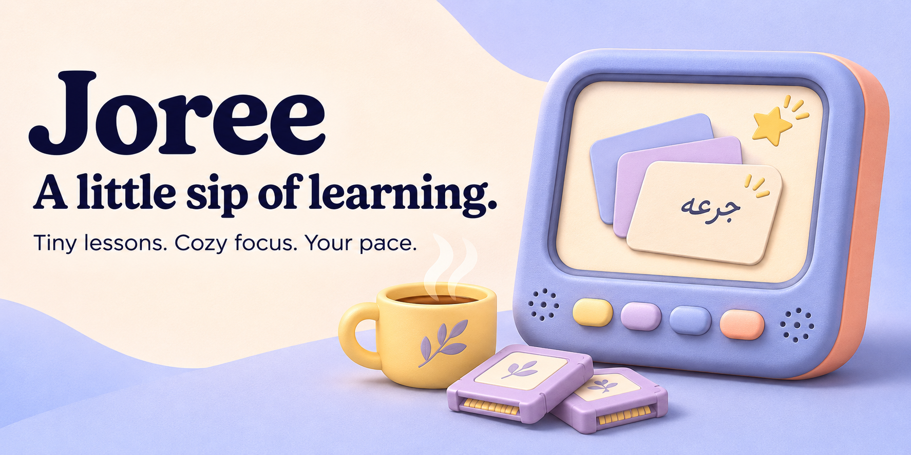
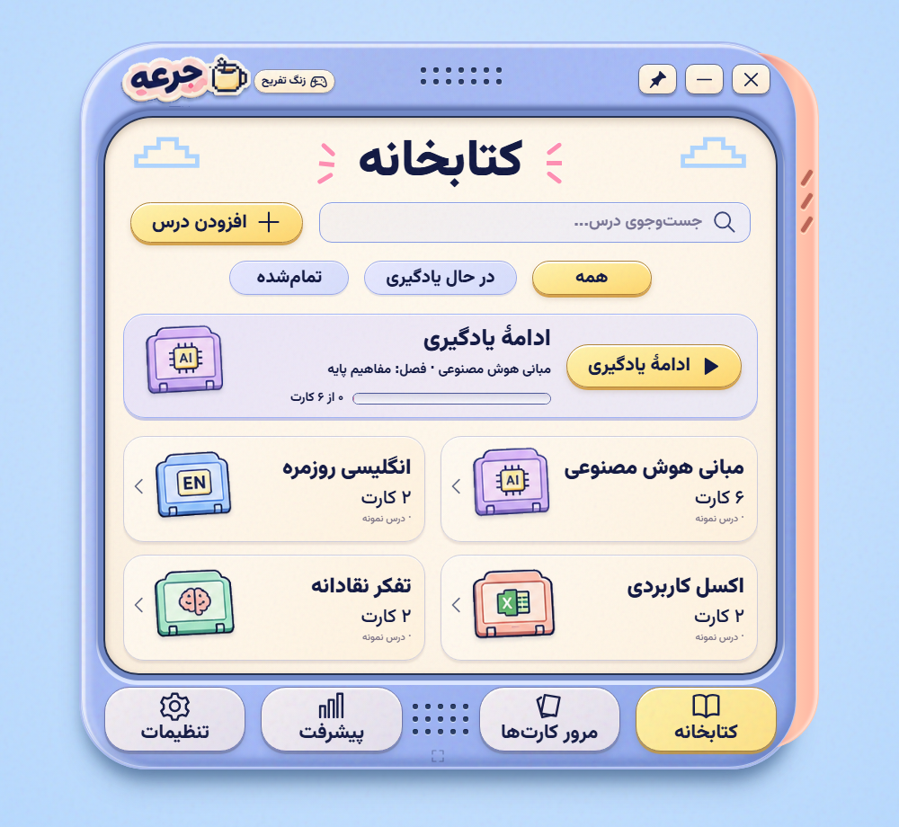
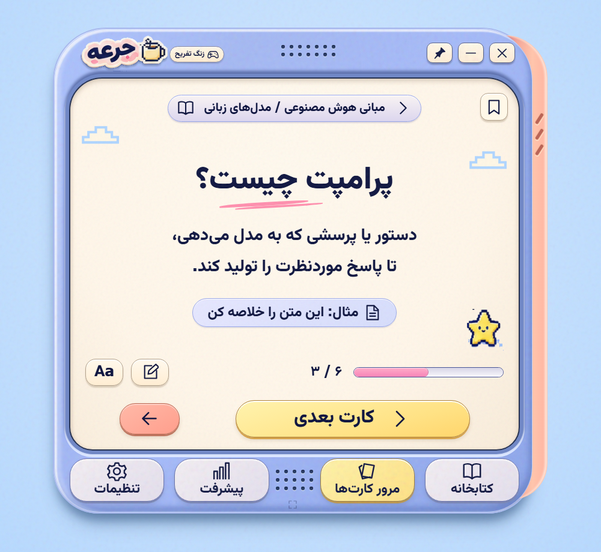
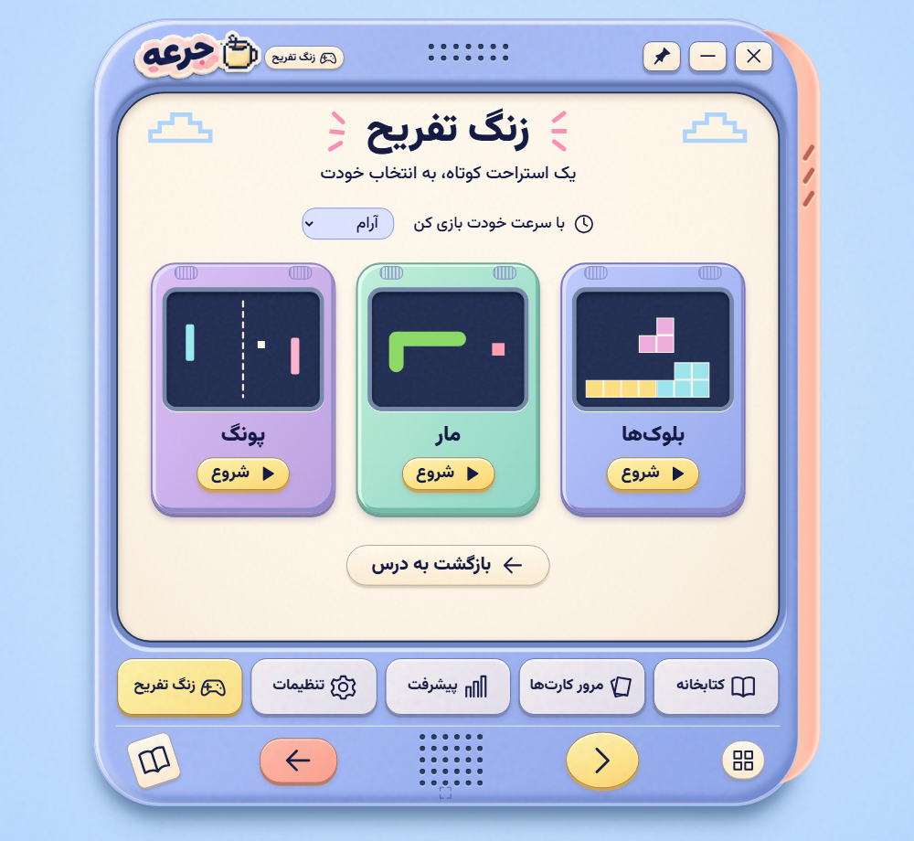
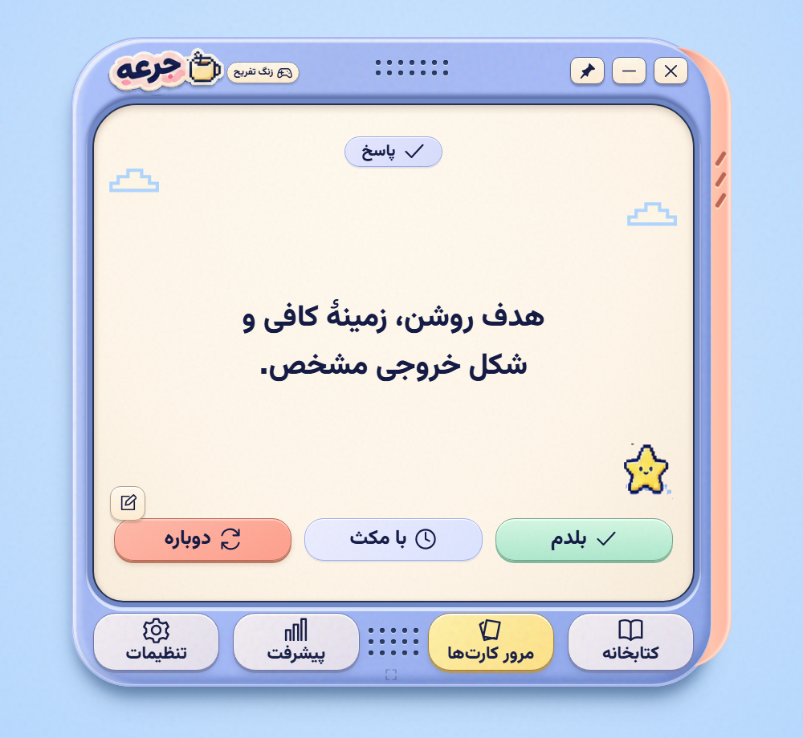
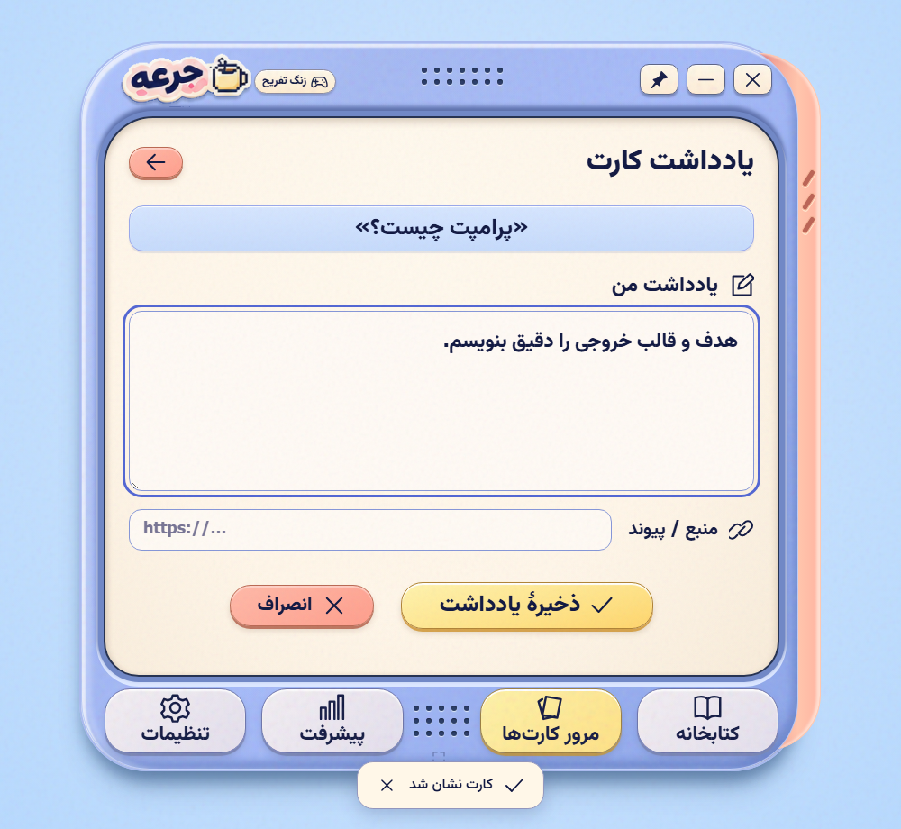
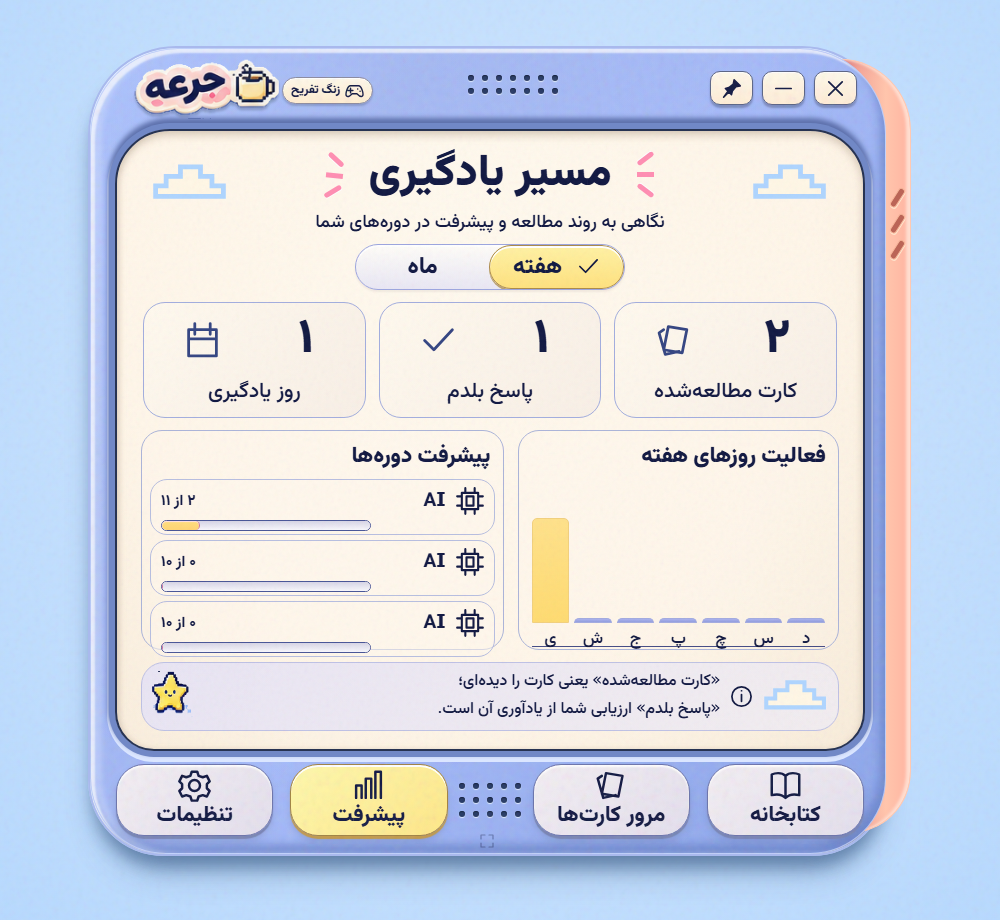
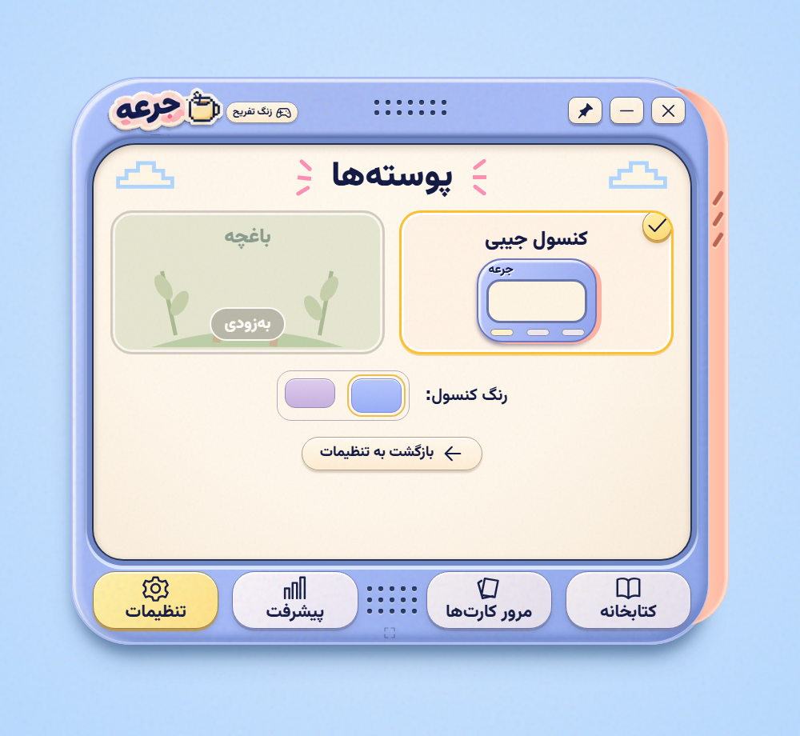
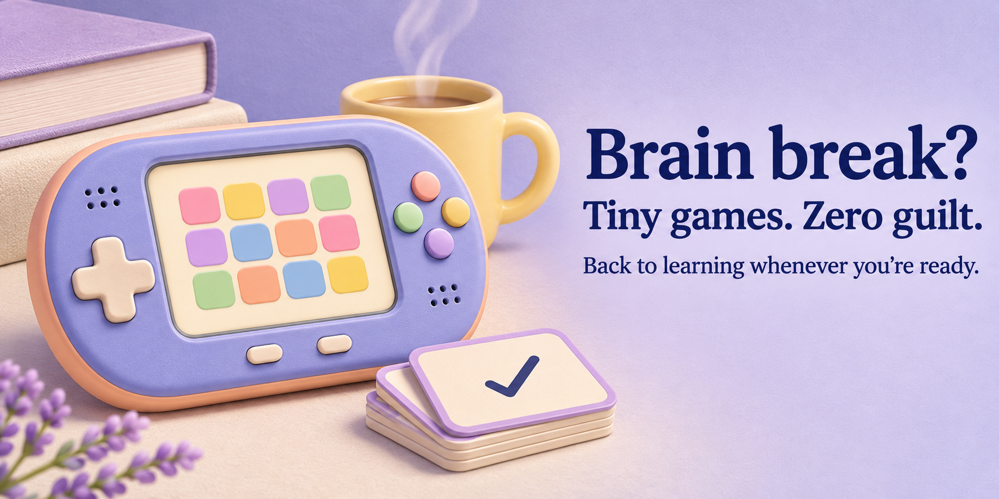

<p align="center"></p>
<h1 align="center">Joree · جرعه</h1>
<p align="center"><strong>A little sip of learning.</strong><br/>A cozy desktop flashcard console for your notes, your brain, and the occasional Snake break.</p>
<p align="center">
  <a href="https://github.com/Hamrez95/Joree/releases/latest"></a>
  <a href="https://github.com/Hamrez95/Joree/actions/workflows/windows.yml"></a>
  
  
</p>
<p align="center"><a href="#download--get-cozy"><strong>Download</strong></a> · <a href="#the-real-thing">Screenshots</a> · <a href="#bring-your-own-brain-food">Add a lesson</a> · <a href="#for-the-curious-and-the-code-tinkerers">Build it</a> · <a href="README.fa.md">فارسی</a></p>


<sub>AI-generated promotional artwork. The actual interface is shown in the screenshot gallery below.</sub>

## Meet your tiny study buddy

**جرعه** means **a sip** in Persian. That's the idea: take a small lesson, give it a little attention, and come back for another sip when you're ready.

Joree turns Markdown lessons into flashcards inside a pastel handheld-console interface. Read a card, try a question, reveal the answer, leave a note, and keep your place. Your lessons and progress live on your computer. Coffee is optional.

The app is **Persian-first and right-to-left**. These docs speak English; the console currently speaks Persian.

When Joree is running in the background, press **Ctrl+J** to show or hide it.

## Download & get cozy

**Current preview: v0.3.7 · Windows x64**

| Pick your adventure              | Download                                                                                                      |
| -------------------------------- | ------------------------------------------------------------------------------------------------------------- |
| Install for your Windows account | [**JoreeSetup.exe**](https://github.com/Hamrez95/Joree/releases/download/v0.3.7/JoreeSetup.exe)               |
| Extract and run                  | [Joree-0.3.7-win-x64.zip](https://github.com/Hamrez95/Joree/releases/download/v0.3.7/Joree-0.3.7-win-x64.zip) |
| Write your first lesson          | [Lesson template](https://github.com/Hamrez95/Joree/releases/download/v0.3.7/Joree-lesson-template.md)        |
| Check the download hashes        | [SHA256SUMS.txt](https://github.com/Hamrez95/Joree/releases/download/v0.3.7/SHA256SUMS.txt)                   |

### Before the first sip

You need **64-bit Windows**, the **[.NET 10 Desktop Runtime](https://dotnet.microsoft.com/en-us/download/dotnet/10.0)**, and **[Microsoft Edge WebView2 Runtime](https://developer.microsoft.com/en-us/microsoft-edge/webview2/)**. They may already be installed on your PC.

1. Download and run `JoreeSetup.exe`.
2. Install for your own Windows account. The app installer uses **no administrator elevation**.
3. Open **جرعه** on your desktop, or search **Joree** in Start.
4. Start the eight-lesson Persian workplace AI path, or bring your own Markdown.

The app runs locally without Node, a development server, a separate browser, an account, or an AI service. The ZIP uses the same shared .NET and WebView2 prerequisites; it does **not** bundle those runtimes.

**Work laptop?** Installing missing runtimes or running an unsigned preview may still need your organization's approval. You don't need to weaken Windows security settings.

[Full Windows install guide →](docs/installation.md)

## Your first learning path

The shelf now starts with **8 Persian lessons and 83 substantial cards** about workplace AI: LLM basics, prompting, RAG, evaluation, internal infrastructure, agents, platform choices, and a final project. Includes **24 self-check questions**, official sources, four local diagrams, and a small dependency-free lab. Practice and independent project work are required; reading the cards alone does not guarantee midlevel proficiency.

[Course index](public/lessons/company-ai/README.md) · [All lessons in one Markdown file](public/lessons/company-ai/company-ai-complete.md) · [Runnable practice lab](public/lessons/company-ai/lab)

## The real thing

These are **actual interface captures from browser-based UI tests**, not generated mockups. The installed Windows app uses the same frontend.

|                 Your lesson shelf                  |                      One card at a time                       |                A tiny brain break                |
| :------------------------------------------------: | :-----------------------------------------------------------: | :----------------------------------------------: |
|  |  |  |

<details>
<summary><strong>More cozy corners: answers, notes, progress, and themes</strong></summary>

|                   Think, then reveal                   |                  Make it yours                   |
| :----------------------------------------------------: | :----------------------------------------------: |
|        |   |
|  |  |

More captures: [docs/screenshots](docs/screenshots). Original designs: [reference map](docs/reference-map.md).

</details>

## What's in the little console?

- **A cartridge-style library.** Search Persian course names, filter your shelf, open chapters, and continue where you left off.
- **A shelf with branches.** Group lessons into nested collections such as AI → Agents or create a separate Ladder collection. Pick a collection when importing or move a lesson later.
- **Room for the good stuff.** A slimmer console frame and quieter study controls keep the lesson text front and center.
- **Just-right reading.** Collapse the collection shelf, choose smaller lesson text, and read justified Persian paragraphs. Settings keep their back button in view.
- **A little breathing room.** The lesson filters now sit clear of the open collection tree.
- **Short study cards.** Read, go back, move forward, and adjust the text size.
- **Think → reveal → rate.** Mark an answer as familiar, hesitant, or worth another try; review dates follow your response.
- **Notes and bookmarks.** Keep the thought you don't want to lose next to its card.
- **Your real progress.** Cards seen, recall ratings, study days, and milestones start from your own activity.
- **A Windows home.** Resize from any edge or corner; screens and lesson-import controls adapt to the available space. Includes compact study mode, optional always-on-top, a tray icon, and remembered window size and position.
- **Local storage and backups.** The Windows app saves learning data in SQLite and exports/restores JSON backups.
- **Three optional games.** Blocks, Snake, and Pong. Yes, you can open them whenever you like.
- **A calmer pace.** Reduced or disabled motion, local fonts, and button sound that starts off.


<sub>Promotional illustration. The actual games are visible in the app screenshots.</sub>

## Bring your own brain food

Keep your `.md` file anywhere convenient — Documents is a perfectly good home. You don't have to put it in the installation folder.

Choose **کتابخانه → افزودن درس → انتخاب فایل** (Library → Add lesson → Choose file), check the preview, edit the name if you like, then choose **افزودن به کتابخانه** (Add to library). Drag-and-drop and pasted Markdown work too.

Each card starts with a title and some text. Put `---` on its own line between cards:

```markdown
# What is a prompt?

A prompt is the instruction or question you give a language model.

---

# What makes a useful prompt?

Think of three ingredients before revealing the answer.
پاسخ: A clear goal, enough context, and the desired output format.
```

The literal Persian marker **`پاسخ:`** introduces an answer. Use UTF-8 files no larger than 2 MB. Keep each card focused on one idea; your future self will appreciate it.

After import, Joree stores its own copy. Moving the original file won't remove the lesson. Editing the original won't automatically update an imported course.

**Starting points:** [template](examples/template-fa.md) · [simple lesson](examples/simple.md) · [question cards](examples/questions.md) · [format reference](docs/lesson-format.md) · [راهنمای فارسی](docs/adding-lessons.md)

PDF, Word, and PowerPoint aren't direct lesson inputs yet. Convert their content to the card format first.

## Where does my stuff live?

| Item                               | Location                                   |
| ---------------------------------- | ------------------------------------------ |
| Installed app                      | `%LOCALAPPDATA%\Programs\Joree\app-0.3.7\` |
| Learning database                  | `%LOCALAPPDATA%\Joree\learning.sqlite3`    |
| Window position                    | `%LOCALAPPDATA%\Joree\window.json`         |
| Host error log, if an error occurs | `%LOCALAPPDATA%\Joree\errors.log`          |

Use **تنظیمات → گرفتن نسخهٔ پشتیبان** (Settings → Create backup) before moving to another PC. Browser-preview data uses browser storage and can move into the Windows app through backup/restore.

Closing the console hides it in the system tray. Choose **خروج کامل** (Exit) from its tray menu to quit. Uninstalling keeps the learning-data folder.

## For the curious and the code tinkerers

The UI is **Svelte 5 + TypeScript + Vite**, with custom CSS, local Vazirmatn fonts, and Canvas games. The Windows preview is a **.NET 10 WinForms / WebView2 host**, using Windows' SQLite library.

`src-tauri/` is an earlier scaffold. It isn't the host used by the download.

### Run the UI

Use a Node version with TypeScript stripping support; CI uses Node 24.

```powershell
git clone https://github.com/Hamrez95/Joree.git
cd Joree
npm ci
npm run dev
```

Open `http://127.0.0.1:1420`.

### Check it & build the Windows package

On Windows, install the SDK in `global.json`, PowerShell 7, and the runtimes above:

```powershell
npm run check
npm test
npx playwright test
pwsh -NoProfile -File scripts/build-windows.ps1
```

Playwright uses Microsoft Edge and starts the UI server when needed. The Windows script restores dependencies and writes the installer, ZIP, template, install guide, and checksums into `release/`.

The [Windows workflow](.github/workflows/windows.yml) runs UI checks, unit/browser tests, packaging, and native smoke checks. [Contributing guide →](CONTRIBUTING.md)

```text
src/          UI, lesson parsing, review scheduling, games
windows/      Windows host, SQLite, per-user installer
src-tauri/    Earlier Tauri scaffold
examples/     Importable lesson templates
docs/         Guides, captures, design references, artwork
scripts/      Packaging and asset export
tests/        Logic and browser-flow checks
```

## The honest little roadmap

This is an **early preview**. Core local learning flows and the installer work; unfinished pieces include:

- Advanced lesson metadata, author-supplied IDs, and updates that preserve card identities.
- Optional Windows sign-in startup and native system reminders.
- The garden theme — currently labeled **coming soon**.
- Further visual matching and broader desktop/DPI verification.

Preview binaries are **unsigned**. [Verification notes](docs/verification.md) describe the checks actually run.

Found a rough edge? [Open an issue](https://github.com/Hamrez95/Joree/issues/new/choose). Small, reproducible bug reports make excellent little gifts.

## Credits & license status

Built by [Hamrez95](https://github.com/Hamrez95). Persian typography uses [Vazirmatn](https://github.com/rastikerdar/vazirmatn). The app icon and two promotional illustrations were AI-generated; their prompts are in [branding notes](docs/branding.md).

A project-wide license has not been selected yet. Dependency and font licenses remain their own.
