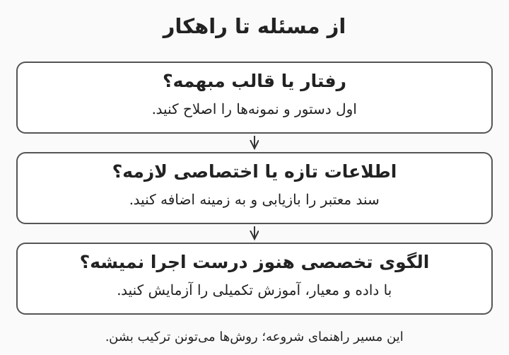

# ۱. از مسئلهٔ شرکت تا مدل زبانی

وقتی یک همکار میگه «برای شرکت هوش مصنوعی می‌خوایم»، هنوز مشخص نیست چه چیزی باید ساخته بشه. شاید مسئله با جست‌وجوی بهتر حل بشه، شاید یک دستیار نوشتن کافی باشه و شاید واقعاً به سامانه‌ای نیاز باشه که ابزار اجرا کنه. این درس نقطهٔ شروع مسیر هشت‌درسی جرعه‌ست و هیچ پیش‌زمینه‌ای از هوش مصنوعی نمی‌خواد. هدف اینه که بتونید یک کاربرد واقعی را تعریف کنید، فرق مدل با محصول را بفهمید و محدودیت پاسخ‌های زبانی را تشخیص بدید. مثال پیوستهٔ مسیر، دستیار آیین‌نامه و پشتیبانی داخلی یک شرکت فرضیه؛ هیچ عدد یا سیاست این مثال، اطلاعات شرکت شما نیست.

هدف‌های یادگیری: تشخیص هوش مصنوعی، یادگیری ماشین و مدل زبانی؛ توضیح توکن و زمینه؛ انتخاب میان دستور، بازیابی و آموزش تکمیلی؛ نوشتن یک معیار موفقیت قابل‌آزمایش.

---

# مدل، برنامه و دستیار چه فرقی دارن؟

هوش مصنوعی (Artificial Intelligence) نام کلی روش‌هایی‌ه که برای کارهایی مثل تشخیص تصویر، پیش‌بینی یا تولید متن به کار میان. یادگیری ماشین (Machine Learning) بخشی از این حوزه‌ست که الگوها را از داده یاد می‌گیره؛ یادگیری عمیق (Deep Learning) هم از شبکه‌های عصبی (Neural Networks) چندلایه استفاده می‌کنه. مدل زبانی بزرگ (Large Language Model یا LLM) می‌تونه بر اساس ورودی، ادامهٔ متن تولید کنه، اما خودِ مدل، حساب کاربری یا دسترسی به پوشهٔ منابع انسانی نداره. محصولی مثل دستیار داخلی، مدل را کنار رابط کاربری، جست‌وجو، کنترل دسترسی و ثبت رویداد قرار میده. مثل تفاوت موتور و ماشین، این تشبیه فقط برای جداکردن جزء از سامانه‌ست؛ مدل هم در کار واقعی به اجزای پیرامونی نیاز داره.

مثال: اگر مدل بگه «مرخصی را ثبت کردم» ولی برنامه هیچ ابزاری برای ثبت مرخصی نداشته باشه، هیچ درخواستی ثبت نشده. متنِ تولیدشده، مدرک اجرای کار نیست؛ شناسهٔ ثبت از سامانهٔ واقعی، مدرک بهتری‌ه.

---

# داخل مدل چه چیزی یاد گرفته میشه؟

معماری ترنسفورمر (Transformer) از سازوکار توجه (Attention) برای ترکیب اطلاعاتِ بخش‌های مختلف دنباله استفاده می‌کنه؛ توجه در این‌جا یک محاسبه‌ست و به معنی آگاهی انسانی نیست. پیش‌آموزش (Pretraining) مرحلهٔ یادگیری الگوهای عمومی از داده‌ست و در بسیاری از مدل‌های مولد متنی، پیش‌بینی توکن بعدی بخشی از هدف یادگیریه. آموزش نظارت‌شده (Supervised Fine-tuning) می‌تونه با نمونهٔ دستور و پاسخ، رفتار مدل را برای پیروی از درخواست سازگارتر کنه. یادگیری تقویتی از بازخورد انسانی (Reinforcement Learning from Human Feedback یا RLHF) هم یکی از روش‌های استفاده از ترجیح انسانی برای بهبود رفتار مدله و تنها روش هم‌راستاسازی نیست. این مراحل می‌تونن خروجی را مفیدتر کنن، ولی تضمین نمی‌کنن هر ادعا درست باشه یا مدل به سامانهٔ زندهٔ شرکت دسترسی داشته باشه. [مقالهٔ اصلی ترنسفورمر](https://arxiv.org/abs/1706.03762)، [پژوهش پیروی از دستور با بازخورد انسانی](https://arxiv.org/abs/2203.02155)

مثال: مدل می‌تونه از نمونه‌ها یاد بگیره پاسخ پشتیبانی را مؤدبانه بنویسه، اما این مهارت به معنی دانستن وضعیت تیکت امروز نیست. برای وضعیت واقعی، اتصال مجاز به ابزار لازمه؛ لحن خوب جای دادهٔ زنده را نمی‌گیره.

---

# توکن، زمینه و تولید پاسخ

توکن (Token) واحدی‌ه که مدل متن را با آن پردازش می‌کنه؛ همیشه برابر یک کلمه نیست و ممکنه بخشی از یک واژه باشه. پنجرهٔ زمینه (Context Window) سقف زمینهٔ قابل‌پردازش مدله و معمولاً دستورها، تاریخچه و اسناد واردشده در آن جا می‌گیرن؛ جزئیات سهم ورودی و خروجی به سرویس بستگی داره. هنگام استنتاج (Inference)، مدل از پارامترهای یادگرفته‌شده و زمینه برای تولید ادامه استفاده می‌کنه. نمونه‌گیری (Sampling) می‌تونه باعث بشه یک ورودی، پاسخ‌های متفاوت بده و کاهش تصادفی‌بودن، تضمین حقیقت نیست. برای شمردن توکن فارسی باید شمارندهٔ همان مدل را استفاده کنید؛ نسبت ثابت «هر کلمه چند توکن» برای همهٔ زبان‌ها و مدل‌ها قابل‌اعتماد نیست. [راهنمای تولید متن در Hugging Face](https://huggingface.co/docs/transformers/llm_tutorial)

مثال: اگر کل بایگانی چندساله را در یک پیام جا بدید، ممکنه از سقف ورودی عبور کنید یا نکتهٔ لازم میان متن‌های نامربوط گم بشه. بهتره اول سند مرتبط با سؤال «مرخصی ساعتی» پیدا بشه و بعد بخش لازم به مدل داده بشه.

---

# چرا پاسخ روان می‌تونه غلط باشه؟

توهم مدل (Hallucination) یعنی مدل محتوایی تولید کنه که پشتوانهٔ کافی نداره یا با واقعیت ناسازگاره. روان‌بودن جمله و لحن مطمئن، احتمال درست‌بودن آن را اثبات نمی‌کنه؛ یک شمارهٔ بخشنامهٔ ساختگی هم می‌تونه کاملاً طبیعی به نظر بیاد. دانش حاصل از آموزش با دسترسی زنده به دادهٔ شرکت فرق داره و قراردادن سند در زمینه هم تضمین نمی‌کنه مدل آن را درست تفسیر کنه. برای پاسخ‌های کاری، سؤال را به شاهد قابل‌بررسی وصل کنید و امکان «اطلاعات کافی ندارم» را باز بذارید. یک فهرست از لینک‌های ظاهراً معتبر هم کافی نیست؛ باید بررسی بشه همان بخش از همان سند واقعاً ادعا را پشتیبانی می‌کنه. [راهنمای طراحی و ارزیابی RAG در Microsoft](https://learn.microsoft.com/en-us/azure/architecture/ai-ml/guide/rag/rag-solution-design-and-evaluation-guide)

مثال: در شرکت فرضی، آیین‌نامه دربارهٔ دورکاری کارکنان قراردادی ساکته. پاسخ خوب این سکوت را اعلام می‌کنه و مسیر پرسش از مسئول را نشون میده؛ از روی قانون کارکنان رسمی، قانون تازه نمی‌سازه.

---

# دستور بهتر، بازیابی یا آموزش تکمیلی؟

دستور ورودی (Prompt) هدف و شرایط انجام کار را به مدل میگه؛ اگر قالب خلاصه‌سازی مبهمه، اصلاح آن اولین اقدام مناسبی‌ه. تولید تقویت‌شده با بازیابی (Retrieval-Augmented Generation یا RAG) پیش از تولید پاسخ، اطلاعات مرتبط را از منبع بیرونی پیدا می‌کنه و در اختیار مدل می‌ذاره. آموزش تکمیلی (Fine-tuning) پارامترهای مدل را با نمونه‌های آموزشی تغییر میده و برای بعضی الگوهای رفتاری یا وظایف تخصصی به کار میاد. روش سازگارسازی کم‌رتبه (Low-Rank Adaptation یا LoRA) یکی از راه‌های آموزش کم‌پارامتره؛ به معنی تبدیل پوشهٔ اسناد به حافظهٔ دقیق و قابل‌حذف مدل نیست. برای آیین‌نامه‌ای که مرتب عوض میشه، از بازیابی نسخهٔ معتبر شروع کنید و آموزش تکمیلی را وقتی بررسی کنید که مسئلهٔ باقی‌مانده و دادهٔ آموزشی مناسب دارید. [توضیح LoRA در Hugging Face](https://huggingface.co/docs/peft/main/en/conceptual_guides/lora)

این نمودار یک راهنمای شروعه؛ ممکنه یک محصول هم‌زمان از هر سه روش استفاده کنه. مثال: قالب «پاسخ کوتاه همراه با نام سند» با دستور مشخص میشه، متن آخرین آیین‌نامه با بازیابی میاد و سازگارکردن یک مدل با سبک خروجی تخصصی می‌تونه موضوع یک آزمایش آموزشی جدا باشه.

---

# مسئله را قبل از خرید ابزار بنویسید

خط مبنا (Baseline) نتیجهٔ ساده‌ای‌ه که راهکار تازه باید با آن مقایسه بشه؛ مثلاً جست‌وجوی معمولی در پوشهٔ اسناد. یک شرح مسئلهٔ خوب میگه کاربر کیه، چه کاری انجام میده، داده از کجا میاد و خطای قابل‌قبول چقدره. معیار پذیرش (Acceptance Criteria) هم باید قابل‌آزمایش باشه، مثل «پاسخ، بخش پشتیبان در نسخهٔ معتبر سند را نشون بده». پیشنهاد آموزشی این مسیره که اول یک کاربرد کم‌خطر و محدود را آزمایش کنید و بعد دامنه را گسترش بدید. انتخاب مدل و سخت‌افزار بدون شناخت حجم کار، کیفیت لازم و سیاست داده، بیشتر بر حدس تکیه می‌کنه تا شواهد.

مثال: به‌جای «دستیار همه‌کارهٔ شرکت»، بنویسید «کارمند مجاز بتونه دربارهٔ سه آیین‌نامهٔ عمومی سؤال بپرسه و پاسخ مستند بگیره». زمان یافتن جواب را با جست‌وجوی فعلی مقایسه کنید و سؤال‌های بدون پاسخ را هم در آزمون بذارید.

---

# مرور و واژه‌نامهٔ درس اول

مدل، یک جزء از محصوله و حرف‌زدن دربارهٔ انجام کار با انجام واقعی آن فرق داره. برای اطلاعات تغییرپذیر شرکت، اول منبع معتبر و مسیر بازیابی را طراحی کنید. اگر جواب معلوم نیست، سامانه باید بتونه همین را صریح بگه. خروجی این درس یک برگهٔ مسئله‌ست: کاربر، وظیفه، منبع، خط مبنا و معیار پذیرش.

- مدل زبانی بزرگ (LLM): مدلی برای پردازش و تولید زبان.
- زمینه (Context): اطلاعاتی که در همان درخواست در اختیار مدل قرار می‌گیره.
- استنتاج (Inference): اجرای مدل برای گرفتن خروجی.
- بازیابی (Retrieval): پیداکردن اطلاعات مرتبط از منبع بیرونی.
- آموزش تکمیلی (Fine-tuning): تغییر پارامترهای مدل با دادهٔ آموزشی.

تمرین پایانی: یک کار پرتکرار شرکت را انتخاب کنید و برگهٔ مسئلهٔ آن را بنویسید. تا وقتی داده و معیار روشن نشده، نام محصول یا کارت گرافیک را در پیشنهاد وارد نکنید.

---

# تمرین ۱: دستیار ادعا می‌کنه درخواست را ثبت کرده؛ چه چیزی را بررسی می‌کنید؟

فرض کنید دستیار فقط چت می‌کنه و هیچ اتصال ثبت درخواستی نداره. توضیح بدید چرا جملهٔ «انجام شد» کافی نیست و کاربر چه شاهدی لازم داره.

پاسخ: مدل فقط متن تولید کرده و ابزار ثبت درخواست اجرا نشده. باید نتیجهٔ سامانهٔ واقعی، مثل شناسهٔ درخواست یا وضعیت قابل‌استعلام، وجود داشته باشه. تا آن زمان پاسخ درست «پیش‌نویس آماده‌ست» یا «امکان ثبت ندارم» خواهد بود.

---

# تمرین ۲: قانون مرخصی عوض شده؛ کدام مسیر را اول امتحان می‌کنید؟

مدل هنوز قانون قدیمی را جواب میده. بین اصلاح دستور، بازیابی نسخهٔ جدید و آموزش تکمیلی انتخاب کنید و دلیل بیارید.

پاسخ: اول نسخهٔ معتبر سند و مسیر بازیابی را اصلاح می‌کنیم تا دادهٔ تازه همراه با تاریخ و شاهد در زمینه قرار بگیره. دستور هم باید پاسخ را به همان شاهد محدود کنه. آموزش تکمیلی، راه پیش‌فرض برای به‌روزکردن آیین‌نامه نیست و حذف قانون قدیمی از پارامترها هم ساده و تضمین‌شده نیست.

---

# تمرین ۳: یک معیار موفقیت قابل‌آزمایش بسازید

عبارت «جواب‌ها خوب باشن» را برای دستیار آیین‌نامه به یک معیار روشن تبدیل کنید. یک حالت بدون پاسخ را هم در نظر بگیرید.

پاسخ: نمونهٔ معیار اینه که برای سؤال‌های پاسخ‌پذیر، پاسخ با بند درست سند معتبر پشتیبانی بشه و برای سؤال‌های خارج از اسناد، ندانستن اعلام بشه. آستانهٔ عددی را مسئول کاربرد با توجه به ریسک تعیین می‌کنه. سؤال‌ها و پاسخ‌های مرجع باید پیش از مقایسهٔ راهکارها آماده بشن.
