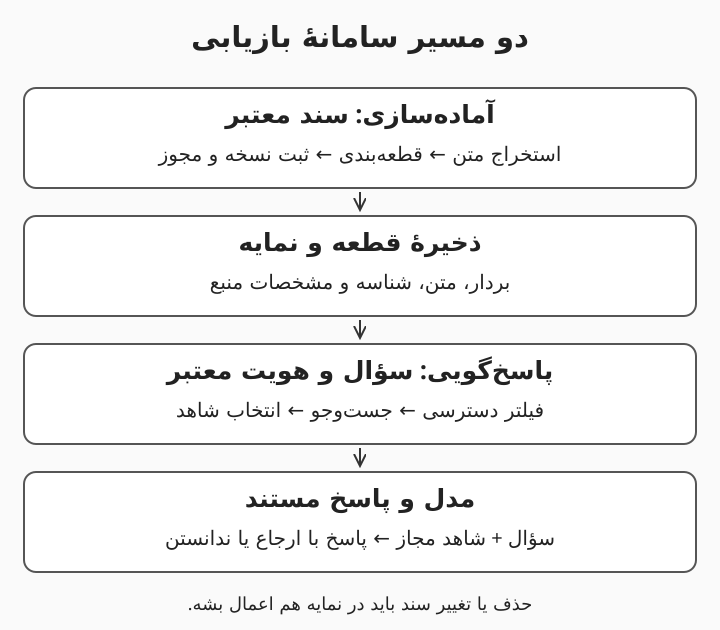

# ۳. ساخت RAG؛ از پوشهٔ اسناد تا پاسخ مستند

بازیابی وقتی ارزش پیدا می‌کنه که کاربر بتونه پاسخ را به سند واقعی برگردونه. صرفاً قراردادن فایل‌ها در یک پایگاه برداری، دستیار قابل‌اعتماد نمی‌سازه؛ کیفیت استخراج، نسخهٔ سند و سطح دسترسی هم در نتیجه دخالت دارن. این درس معماری یک سامانهٔ تولید تقویت‌شده با بازیابی (Retrieval-Augmented Generation یا RAG) را مرحله‌به‌مرحله باز می‌کنه. پیش‌نیازش دو درس قبلی‌ه و هنوز به برنامه‌نویسی یا خرید سرور نیاز ندارید. هدف، طراحی یک نمونهٔ قابل‌آزمایش برای آیین‌نامه‌های داخلی‌ه؛ پیاده‌سازی مقیاس بالا در محدودهٔ این درس نیست.

هدف‌های یادگیری: طراحی ورود سند و جست‌وجو؛ درک بردار و جست‌وجوی ترکیبی؛ حفظ شاهد و مجوز دسترسی؛ تشخیص جای خرابی در زنجیره.

---

# دو مسیر جدا: آماده‌سازی و پاسخ‌گویی

در مسیر آماده‌سازی، سند دریافت و متن آن استخراج میشه؛ بعد بخش‌های قابل‌جست‌وجو همراه با مشخصات منبع ذخیره میشن. در مسیر پاسخ‌گویی، سؤال کاربر با توجه به مجوزش جست‌وجو میشه و چند بخش مرتبط به مدل می‌رسه. مدل از سؤال و شاهد، پاسخ می‌سازه و برنامه باید ارجاع‌ها را به متن اصلی وصل کنه. این تفکیک کمک می‌کنه به‌روزرسانی سند از هر بار پرسیدن سؤال جدا باشه. اگر سند حذف یا منقضی شد، نسخهٔ جست‌وجوپذیر و حافظه‌های موقت مرتبط هم باید به‌روز بشن؛ وگرنه پاسخ قدیمی دوباره برمی‌گرده. [مراحل طراحی RAG در Microsoft](https://learn.microsoft.com/en-us/azure/architecture/ai-ml/guide/rag/rag-solution-design-and-evaluation-guide)

مثال: آیین‌نامهٔ مرخصی فقط هنگام تغییر دوباره پردازش میشه، ولی هر سؤال کارمند یک جست‌وجوی تازه داره. شناسهٔ نسخه کنار هر بخش نگه داشته میشه تا پاسخ معلوم کنه از کدام مقررات استفاده کرده.

---

# استخراج و قطعه‌بندی؛ کیفیت از همین‌جا شروع میشه

بازشناسی نوری نویسه‌ها (Optical Character Recognition یا OCR) نوشتهٔ داخل تصویر را به متن تبدیل می‌کنه، ولی خطاهای آن باید با نمونه‌برداری بررسی بشن. قطعه‌بندی (Chunking) یعنی متن را به بخش‌هایی تقسیم کنیم که هم قابل‌بازیابی باشن و هم معنای لازم را حفظ کنن. اگر عنوان جدول جدا بشه یا تبصره از قانون اصلی دور بیفته، یک قطعهٔ ظاهراً مرتبط ممکنه پاسخ غلط بسازه. هم‌پوشانی (Overlap) بین قطعه‌ها می‌تونه بعضی بریدگی‌ها را کمتر کنه، اما تکرار و هزینه هم ایجاد می‌کنه. اندازهٔ ثابت و جادویی وجود نداره؛ نقطهٔ شروع را با ساختار سند انتخاب کنید و با سؤال‌های واقعی بسنجید.

مثال: جملهٔ «استفاده از این مزیت فقط پس از تأیید مدیر مجازه» را از بند اصلی جدا نکنید. برای هر قطعه، نام سند، شمارهٔ صفحه یا بخش، تاریخ اعتبار و گروه‌های مجاز را به‌عنوان فراداده (Metadata) نگه دارید تا پاسخ بدون شرط لازم ساخته نشه.

---

# بردار معنایی و جست‌وجوی ترکیبی

بازنمایی برداری (Embedding) متن را به مجموعه‌ای از عددها تبدیل می‌کنه تا نزدیکی معنایی قابل‌محاسبه بشه. جست‌وجوی برداری (Vector Search) قطعه‌هایی را پیدا می‌کنه که بازنمایی‌شان به سؤال نزدیکه؛ نزدیکی بردار، تضمین حقیقت یا ارتباط کامل نیست. جست‌وجوی واژگانی (Keyword Search) برای عبارت دقیق، کد محصول و شمارهٔ بخشنامه مفیده. جست‌وجوی ترکیبی (Hybrid Search) از هر دو مسیر کمک می‌گیره و نتایج را با یک روش ادغام کنار هم قرار میده. بازرتبه‌بندی (Reranking) هم در مرحلهٔ بعد می‌تونه نامزدها را با توجه دقیق‌تر به سؤال دوباره مرتب کنه؛ اثرش باید در برابر هزینه و تأخیر سنجیده بشه. [توضیح جست‌وجوی ترکیبی Microsoft](https://learn.microsoft.com/en-us/azure/search/hybrid-search-overview)

مثال: کاربر می‌پرسه «مرخصی بچه‌دارشدن» ولی سند از عبارت «مرخصی والدین» استفاده کرده؛ مسیر معنایی ممکنه کمک کنه. برای «بخشنامهٔ HR-17»، تطبیق دقیق هم مهمه. مدل بردارساز سؤال و اسناد باید در یک فضای سازگار باشه؛ عوض‌کردن بردارساز معمولاً بازسازی بردارهای اسناد را لازم می‌کنه.

---

# انتخاب مخزن و حفظ دسترسی

پایگاه برداری (Vector Database) محل نگهداری و جست‌وجوی بردارها و مشخصات مرتبطه؛ همیشه لازم نیست پایگاه تازه‌ای وارد معماری کنید. افزونهٔ pgvector جست‌وجوی برداری را به PostgreSQL اضافه می‌کنه و Qdrant یک گزینهٔ تخصصی برای جست‌وجوی برداری و فیلتر فراداده‌ست. انتخاب را با حجم داده، تأخیر، فیلترها، پشتیبان‌گیری (Backup) و تجربهٔ تیم انجام بدید، نه فقط نام محصول. فهرست کنترل دسترسی (Access Control List یا ACL) باید قبل از ورود قطعه به زمینهٔ مدل اعمال بشه؛ جملهٔ «اسناد محرمانه را لو نده» جای این کنترل را نمی‌گیره. هویت و گروه کاربر را از سامانهٔ احراز هویت (Authentication) بگیرید، نه از متن سؤال یا پیشنهادی که مدل تولید کرده. [مستندات pgvector](https://github.com/pgvector/pgvector)، [معرفی Qdrant](https://qdrant.tech/documentation/overview/)

مثال: اگر یک کارمند به گزارش حقوق دسترسی نداره، آن گزارش نباید حتی برای ساخت جواب به مدل فرستاده بشه. آزمون مهم اینه که همان سؤال را با دو حساب مجاز و غیرمجاز بپرسید و قطعه‌های بازیابی‌شده را هم بررسی کنید.

---

# پاسخ مستند و عیب‌یابی مرحله‌ای

اتکای پاسخ به منبع (Groundedness) یعنی ادعاهای پاسخ واقعاً با شاهد ارائه‌شده پشتیبانی بشن. هنگام تولید، نام و شناسهٔ قطعه‌ها را همراه متن بدید و از مدل بخواید برای هر ادعای مهم ارجاع بده. برنامه باید وجود شناسهٔ ارجاع را بررسی کنه، اما ارزیابی معنایی هم لازمه چون ارجاعِ موجود ممکنه ادعا را تأیید نکنه. اگر پاسخ غلطه، اول ببینید متن درست استخراج شده، بعد قطعهٔ درست بازیابی شده و در آخر مدل آن را درست فهمیده یا نه. برای اسناد متناقض، قاعدهٔ اعتبار و مرجع حل اختلاف لازم دارید؛ مدل نباید بی‌خبر یک نسخه را انتخاب کنه.

مثال: پاسخ میگه «دورکاری دو روزه مجازه» ولی شاهد دربارهٔ واحد دیگری‌ه. اگر قطعهٔ نامربوط به مدل رسیده، سراغ فیلتر واحد و جست‌وجو برید؛ اگر شاهد درست بوده و قید واحد حذف شده، دستور و ارزیابی تولید پاسخ را اصلاح کنید.

---

# مرور، واژه‌نامه و طراحی نمونه

سامانهٔ بازیابی از متن سالم، قطعهٔ معنادار و مشخصات معتبر شروع میشه. جست‌وجوی ترکیبی می‌تونه هم عبارت‌های دقیق و هم بیان‌های متفاوت یک مفهوم را پوشش بده، ولی نتیجه باید آزموده بشه. کنترل دسترسی پیش از ساخت زمینه انجام میشه و پاسخ به شاهد قابل‌بررسی وصل می‌مونه. با جداکردن خطای استخراج، جست‌وجو و تولید، اصلاح سامانه هدفمندتر میشه.

- بازنمایی برداری (Embedding): نمایش عددی برای سنجش شباهت.
- قطعه‌بندی (Chunking): تقسیم سند به بخش‌های قابل‌بازیابی.
- فراداده (Metadata): مشخصات منبع، نسخه و دسترسی.
- بازرتبه‌بندی (Reranking): مرتب‌کردن دوبارهٔ نتایج نامزد.
- اتکا به منبع (Groundedness): پشتیبانی ادعا توسط شاهد.

تمرین پایانی: سه سند ساختگی بسازید؛ یک سند عمومی، یک سند مخصوص مدیر و یک نسخهٔ منقضی. برای هرکدام قطعه، شناسه، گروه مجاز و تاریخ اعتبار تعریف کنید. پنج سؤال بنویسید و پیش از استفاده از مدل، دستی مشخص کنید چه قطعه‌هایی باید برگردن.

---

# تمرین ۱: جواب غلطه؛ آیا مدل را عوض می‌کنید؟

سند درست در بایگانی هست ولی قطعهٔ مربوط در زمینهٔ پاسخ دیده نمیشه. اولین بررسی شما چیه؟

پاسخ: اول مسیر استخراج، قطعه‌بندی، نمایه‌سازی و فیلترهای جست‌وجو را بررسی می‌کنیم. وقتی شاهد لازم به مدل نرسیده، تعویض مدل تولیدکننده درمان مستقیم مشکل نیست. با جست‌وجوی دستی همان سند و ثبت نتایج میشه محل خرابی را محدود کرد.

---

# تمرین ۲: آیا فیلتر محرمانگی بعد از پاسخ کافیه؟

گزارش حقوق به زمینهٔ مدل فرستاده شده ولی برنامه قرار بوده کلمات حساس را از جواب پاک کنه. اشکال طراحی را توضیح بدید.

پاسخ: دادهٔ غیرمجاز از مرز دسترسی عبور کرده و ممکنه در پاسخ غیرمستقیم یا گزارش‌ها هم ظاهر بشه. فیلتر دسترسی باید پیش از بازیابی نهایی و ساخت زمینه، با هویت معتبر کاربر اعمال بشه. پاک‌کردن چند کلمه از پاسخ جای کنترل دسترسی را نمی‌گیره.

---

# تمرین ۳: چرا شمارهٔ بخشنامه در جست‌وجو گم شده؟

جست‌وجوی معنایی اسناد کلی برمی‌گردونه ولی سند HR-17 را پیدا نمی‌کنه. چه تغییری را آزمایش می‌کنید؟

پاسخ: مسیر واژگانی برای تطبیق دقیق شناسه را اضافه و نتیجه را با مسیر برداری ترکیب می‌کنیم. سپس بررسی می‌کنیم شناسه هنگام استخراج و قطعه‌بندی حفظ شده باشه. موفقیت را روی مجموعه‌ای شامل کدها و سؤال‌های معنایی می‌سنجیم تا یک گروه قربانی گروه دیگر نشه.
