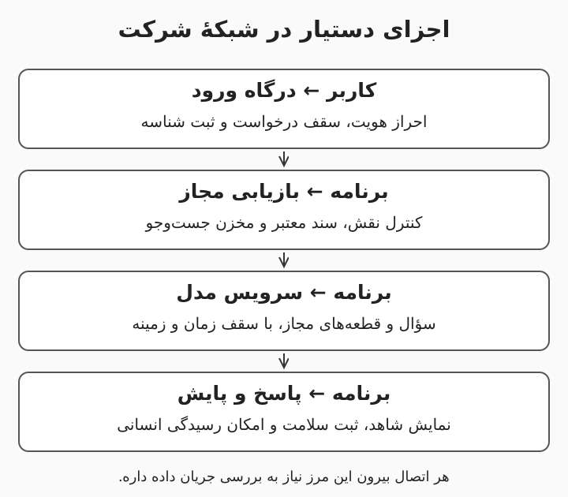

# ۵. هوش مصنوعی داخلی؛ زیرساخت را با آزمون انتخاب کنید

اگر قرار باشه مدل داخل شرکت اجرا بشه، تصمیم فقط خرید کارت گرافیک نیست. باید مشخص بشه چه مدلی، با چه طول ورودی، برای چند کاربر و با چه زمان پاسخی کار می‌کنه. این درس اجزای زیرساخت را در حد طراحی یک آزمایش ظرفیت توضیح میده و برآورد قطعی خرید ارائه نمی‌کنه. پیش‌نیازش مبانی و ارزیابی‌ه؛ آشنایی مقدماتی با سرور و شبکه کمک می‌کنه ولی برای فهم مفهوم‌ها ضروری نیست. برای نصب واقعی، تیم زیرساخت باید سازگاری سیستم‌عامل، درایور، برق، خنک‌سازی و سیاست شبکه را بررسی کنه.

هدف‌های یادگیری: تفاوت استنتاج و آموزش؛ شناخت مصرف حافظه؛ انتخاب اجرای آزمایشی و سرویس‌دهی؛ ساخت برگهٔ آزمون پیش از خرید.

---

# اجرای داخلی چه اجزایی داره؟

میزبانی داخلی (Self-hosting) یعنی مسئولیت اجرای سرویس روی زیرساخت در اختیار سازمان قرار بگیره. لایهٔ سرویس‌دهی مدل (Model Serving) درخواست را دریافت می‌کنه، مدل را اجرا می‌کنه و پاسخ میده؛ اما ورود کاربران، بازیابی اسناد و مدیریت مجوز معمولاً اجزای جداگانه هستن. معماری می‌تونه شامل درگاه درخواست، سرویس مدل، موتور بازیابی، مخزن سند و پایش باشه. داخلی‌بودن مدل به معنی داخلی‌بودن همهٔ اجزا نیست؛ یک بردارساز یا ابزار بیرونی هنوز ممکنه داده را خارج کنه. مرزهای شبکه و جریان داده را روی نمودار مشخص کنید و هر اتصال را با سیاست واقعی سازمان تطبیق بدید.

مثال: اگر مدل در اتاق سروره ولی اسناد برای استخراج متن به یک سرویس بیرونی میرن، سامانه کاملاً داخلی نیست. این لزوماً ممنوع نیست، اما باید تصمیم روشن و موردتأیید صاحب داده باشه.

---

# حافظه فقط برای وزن مدل نیست

پارامتر یا وزن (Parameter / Weight) عدد یادگرفته‌شدهٔ مدله و تعداد پارامترها یکی از عوامل مصرف حافظه‌ست. حافظهٔ کارت گرافیک (Video RAM یا VRAM) علاوه بر وزن‌ها، برای داده‌های میانی و حافظهٔ کلید و مقدار (KV Cache) هم مصرف میشه. حافظهٔ کلید و مقدار به نگهداری اطلاعات محاسبات توجه برای ادامهٔ تولید کمک می‌کنه و با طول زمینه و تعداد درخواست‌های فعال تغییر می‌کنه. برای یک مثال محاسباتی ساده، هشت میلیارد وزنِ دوبایتی تقریباً شانزده میلیارد بایت، یعنی شانزده گیگابایت ده‌دهی، فقط برای وزن‌ها لازم دارن. این عدد معادل کل حافظهٔ لازم نیست و نمی‌گه مدل روی یک کارت شانزده‌گیگابایتی با بار موردنظر اجرا میشه. [راهنمای حافظه و مقیاس‌دهی vLLM](https://docs.vllm.ai/en/latest/serving/parallelism_scaling/)

مثال: همان مدل که با یک سؤال کوتاه اجرا میشه ممکنه با ده ورودی بلند به کمبود حافظه بخوره. ظرفیت خرید را با زمینهٔ واقعی و تعداد کاربر هم‌زمان اندازه بگیرید؛ اندازهٔ فایل دانلودی مدل معیار کافی نیست.

---

# کم‌دقت‌سازی و چند کارت گرافیک

کم‌دقت‌سازی (Quantization) نمایش بعضی عددهای مدل را با بیت‌های کمتر انجام میده و می‌تونه مصرف حافظه را کاهش بده. اثر آن بر کیفیت و سرعت به روش، مدل، سخت‌افزار و پیاده‌سازی بستگی داره؛ عبارت «چهاربیتی» به‌تنهایی همهٔ این‌ها را مشخص نمی‌کنه. در همان مثال هشت‌میلیاردپارامتری، ذخیرهٔ ایده‌آل چهاربیتی حدود چهار میلیارد بایت برای وزن خام می‌خواد، اما اطلاعات کمکی و حافظهٔ اجرا به آن اضافه میشن. موازی‌سازی تانسوری (Tensor Parallelism) وزن‌ها و محاسبات را بین چند پردازنده تقسیم می‌کنه و به ارتباط مناسب بین کارت‌ها نیاز داره. جمع ظرفیت دو کارت لزوماً مثل یک کارت با حافظهٔ یکپارچه رفتار نمی‌کنه و هزینهٔ ارتباط ممکنه اثر قابل‌توجهی داشته باشه. [سازگاری روش‌های کم‌دقت‌سازی در vLLM](https://docs.vllm.ai/en/latest/features/quantization/)

مثال: پیش از سفارش چند کارت، یک مدل و روش کم‌دقت‌سازی مشخص را روی گزینهٔ قابل‌آزمایش اجرا کنید. کیفیت فارسی، مصرف حافظه و زمان پاسخ را ثبت کنید؛ صرفاً از روی تعداد بیت، نتیجهٔ کیفیت را حدس نزنید.

---

# اجرای آزمایشی با سرویس سازمانی فرق داره

ابزار Ollama برای اجرای مدل و آزمایش محلی مسیر ساده‌ای فراهم می‌کنه؛ ابزار vLLM برای سرویس‌دهی و مدیریت بار مدل قابلیت‌های تخصصی داره. این دو نام، مدل نیستن و انتخاب هرکدام به معنی انتخاب کیفیت زبانی مشخصی نیست. سازگاری مدل، سیستم‌عامل و کارت را در مستندات همان نسخه بررسی کنید؛ پیش‌فرض‌های ابزارها هم ممکنه عوض بشن. نمونهٔ محلی را بدون احراز هویت و محدودیت به شبکهٔ شرکت باز نکنید و درگاه سرویس مدل را عمومی نذارید. تعداد کاربران، صف درخواست (Request Queue) و سقف زمینه باید در آزمایش کنترل بشه تا کندی یک درخواست کل سرویس را درگیر نکنه. [راهنمای اجرای محلی Ollama](https://docs.ollama.com/faq)، [راهنمای سرویس‌دهی vLLM](https://docs.vllm.ai/en/latest/serving/parallelism_scaling/)

مثال: برای مقایسهٔ دو مدل روی لپ‌تاپ آزمایشگاهی می‌تونید از محیط محلی موردتأیید استفاده کنید. برای سرویس مشترک کارکنان، ورود یکپارچه (Single Sign-on یا SSO)، محدودیت درخواست، ثبت سلامت و پشتیبانی عملیاتی هم به طراحی اضافه میشن.

---

# برگهٔ آزمایش قبل از برگهٔ خرید

واحد پردازش مرکزی (CPU)، حافظهٔ اصلی (RAM)، فضای ذخیره‌سازی و شبکه کنار پردازندهٔ گرافیکی (GPU) روی رفتار سامانه اثر دارن. آموزش از پایه (Pretraining) و آموزش تکمیلی با استنتاج بار یکسانی ندارن؛ منابع مناسب یک سرویس پاسخ‌گویی لزوماً برای آموزش مناسب نیست. در برگهٔ آزمایش، نام و مجوز مدل، دقت عددی، طول ورودی، طول خروجی، تعداد کاربر هم‌زمان و معیار کیفیت را ثبت کنید. هزینهٔ مالکیت (Total Cost of Ownership یا TCO) شامل برق، نگهداری، نیروی تیم و زمان ازکارافتادگی هم میشه. پیشنهاد خرید زمانی معنی‌داره که آزمون نزدیک به بار واقعی، محدودیت محیط و برنامهٔ رشد مشخص شده باشه.

مثال: برای دستیار آیین‌نامه، سه بار آزمایشی تعریف کنید: یک کاربر با متن کوتاه، چند کاربر با متن معمول و بار اوج با متن بلند. اگر بار اوج رد شد، بررسی کنید سقف زمینه، صف یا مدل سبک‌تر مسئله را حل می‌کنه یا واقعاً سخت‌افزار بیشتری لازمه.

---

# مرور، واژه‌نامه و گزارش ظرفیت

زیرساخت داخلی باید کل جریان داده را پوشش بده، نه فقط محل فایل مدل را. حافظهٔ وزن‌ها تنها بخشی از مصرفه و طول زمینه و هم‌زمانی روی ظرفیت اثر دارن. کم‌دقت‌سازی و چند کارت را با مدل و سخت‌افزار واقعی بسنجید. خروجی این درس یک گزارش آزمایشی برای کمک به تصمیم خریده؛ ظرفیت لازم هر شرکت باید جدا سنجیده بشه.

- حافظهٔ کارت گرافیک (VRAM): حافظهٔ در دسترس پردازندهٔ گرافیکی.
- حافظهٔ کلید و مقدار (KV Cache): دادهٔ نگهداری‌شده برای ادامهٔ تولید.
- کم‌دقت‌سازی (Quantization): نمایش عددها با دقت کمتر.
- سرویس‌دهی مدل (Model Serving): ارائهٔ مدل به درخواست‌های کاربران.
- هزینهٔ مالکیت (TCO): هزینهٔ خرید و ادامهٔ بهره‌برداری.

تمرین پایانی: یک جدول ظرفیت با ستون‌های مدل، مجوز، ابزار اجرا، دقت، زمینه، هم‌زمانی، کیفیت، مصرف حافظه و زمان پاسخ بسازید. مقدارهای نامعلوم را «اندازه‌گیری نشده» بنویسید. سه سؤال لازم از تیم زیرساخت را اضافه کنید و پیش از پرشدن این جدول، خرید پیشنهاد ندید.

---

# تمرین ۱: مدل شانزده گیگابایت وزن داره؛ کارت شانزده‌گیگابایتی کافیه؟

در محاسبهٔ ساده فقط وزن‌ها را شمردید. چرا این برآورد برای انتخاب کارت کافی نیست؟

پاسخ: حافظهٔ کلید و مقدار، بافرها، داده‌های میانی و سربار ابزار هم حافظه می‌خوان. طول زمینه و تعداد درخواست‌های فعال این مقدار را تغییر میدن. باید کل مصرف و زمان پاسخ با بار واقعی اندازه‌گیری بشه؛ برابری اندازهٔ وزن و حافظهٔ کارت تضمین اجرا نیست.

---

# تمرین ۲: مدل داخلیه ولی بردارساز بیرون شرکت اجرا میشه؛ چه نتیجه‌ای می‌گیرید؟

اسناد برای تولید بردار به یک سرویس بیرونی ارسال میشن. آیا میشه گفت همهٔ پردازش داخلیه؟

پاسخ: خیر؛ بخشی از داده از مرز شرکت خارج میشه. باید این مسیر در نقشهٔ داده ثبت و با طبقه‌بندی اسناد و قرارداد سرویس بررسی بشه. اگر خروج مجاز نیست، بردارساز و سایر اجزای پردازش هم باید در محیط مجاز قرار بگیرن.

---

# تمرین ۳: نسخهٔ چهاربیتی همیشه بهتره؟

نسخهٔ کم‌دقت حافظهٔ کمتری می‌خواد. چه چیزهایی را قبل از انتخاب اندازه می‌گیرید؟

پاسخ: کیفیت روی مجموعهٔ آزمون فارسی، زمان پاسخ، ظرفیت هم‌زمان، مصرف کل حافظه و سازگاری ابزار و سخت‌افزار را می‌سنجیم. کاهش حجم به‌تنهایی افزایش سرعت یا حفظ کیفیت را تضمین نمی‌کنه. نتیجه باید برای همان نسخهٔ مدل و همان روش ثبت بشه.
